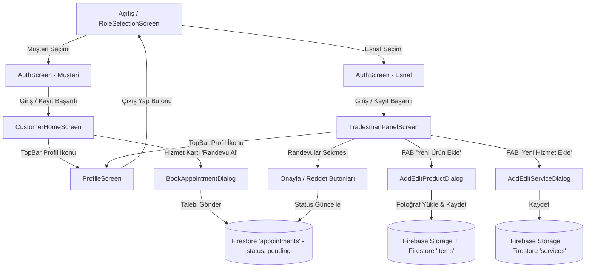
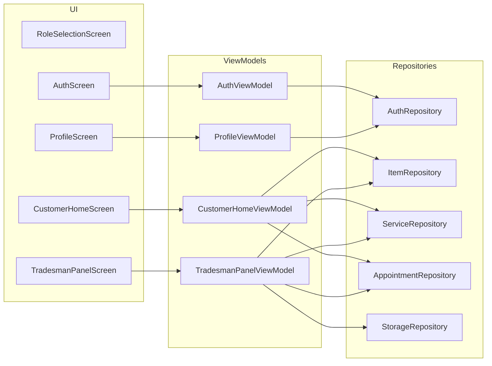
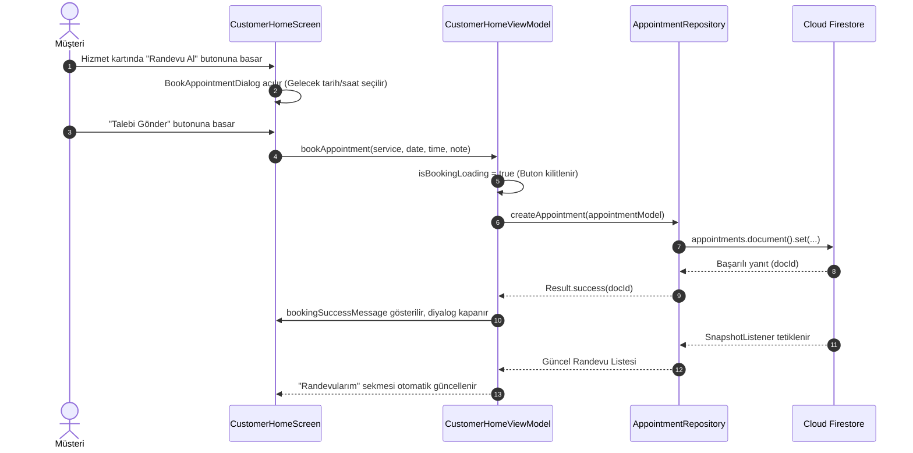
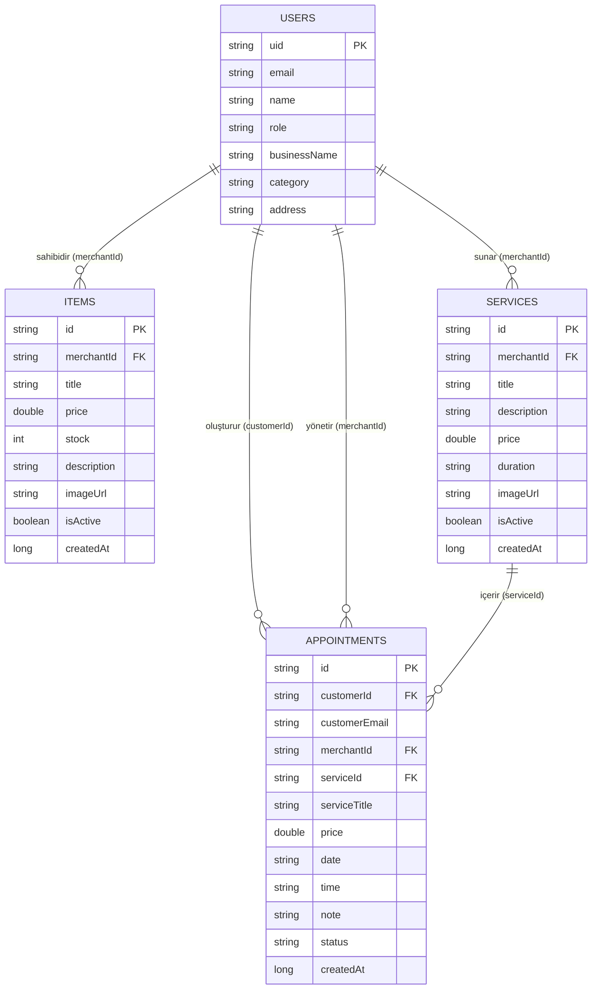

# 📘 ESNAFIM ANDROID UYGULAMASI - TAM KAPSAMLI ANALİZ VE TEKNİK DOKÜMANTASYON (APP AUDIT REPORT)

> **Güncel durum notu — 21 Kasım 2026:** Bu raporun ana gövdesi daha eski bir proje sürümünü anlatır; özellikle “sipariş/ödeme yok”, “favoriler yerel bellekte” ve “yalnızca randevu akışı var” ifadeleri artık geçerli değildir. Güncel kaynakta ürün siparişi ve stok ayırma, yalnızca demo olarak işaretlenen kart ödemesi, hizmet depozitosu, sipariş/randevu takibi ve iptali, esnaf-müşteri ekli dosya sohbeti, favoriler, Çırak asistanı ve `public_merchants` listesi bulunur. **PayTR veya gerçek para tahsilatı yoktur.**
>
> Bu geliştirme turunda sipariş stok güncellemesi sipariş kaydına bağlandı; müşteri/esnaf iptali stok iadesini aynı transaction içinde yapacak biçimde düzenlendi. Esnaf sipariş/randevu/sohbet ekranları tek alanlı Firestore sorgularını kullanır ve sonucu istemcide tarihe göre sıralar; sipariş ekranı için yeni bileşik indeks gerektirmez. Demo veri scriptlerindeki `.firebaserc` okuma sorunu giderildi ve Functions çalışma zamanı Node.js 22'ye alındı. Firebase'deki 55 örnek işletmeye uygun eksik kataloglar eklendi: 106 ürün ve 52 hizmet. Gerçek esnaf kayıtlarına ve mevcut katalog belgelerine dokunulmadı. Firestore kuralları, dizinler veya Functions canlı projeye dağıtılmadı. Cloud Functions'ın çalışması için Firebase plan/faturalandırma koşulları ayrıca karşılanmalıdır.

---

## 1. YÖNETİCİ ÖZETİ

**Esnafım**, yerel esnaflar (küçük ve orta ölçekli işletmeler, terziler, berberler, bakkallar, tesisatçılar vb.) ile müşterileri tek bir dijital platformda buluşturan native bir Android mobil uygulamasıdır. Uygulama; modern **Android Jetpack Compose**, **Material 3**, **MVVM (Model-View-ViewModel)** mimarisi ve Google **Firebase (Authentication, Cloud Firestore, Firebase Storage)** altyapısı kullanılarak geliştirilmiştir.

Uygulama iki temel kullanıcı profili üzerine kurgulanmıştır:
1. **Müşteri (Customer):** Çevredeki esnafların eklediği ürün ve hizmetleri canlı olarak görüntüler, favorilere ekler, hizmetler için gelecek tarihlere randevu talebi oluşturur ve randevularının onay durumunu takip eder.
2. **Esnaf (Merchant / Tradesman):** İşletmesinin ürünlerini (fiyat, stok, açıklama, fotoğraf) ve sunduğu hizmetleri (fiyat, süre, açıklama, fotoğraf) yönetebilir (ekleme, düzenleme, silme) ve müşterilerden gelen randevu taleplerini onaylayabilir veya reddedebilir.

Mevcut kod tabanı incelendiğinde; kullanıcı kimlik doğrulama, dinamik rol seçimi, profil yönetimi, canlı ürün/hizmet ekleme-düzenleme-silme, Firebase Storage'a fotoğraf yükleme, müşteri randevu talebi oluşturma ve esnaf randevu onay/red süreçleri **tamamen çalışır** vaziyettedir. Müşteri ana ekranındaki arama, kategori bazlı Firestore filtrelemesi ve sepet/ödeme sistemleri henüz kodlanmamış veya arayüz seviyesindedir.

---

## 2. UYGULAMANIN AMACI VE GENEL ÇALIŞMA MANTIĞI

### 2.1 Çözülen Problem ve Hedef Kitle
* **Problem:** Yerel esnafın dijitalleşme maliyetlerinin yüksek olması ve müşterilerin mahallelerindeki esnafların ürün, hizmet ve uygun randevu saatlerine erişmekte zorlanması.
* **Hedef Kitle:** Yerel esnaflar (kuaförler, terziler, tamirciler, fırınlar vb.) ve mahalle esnafından hızlı hizmet/ürün almak isteyen müşteriler.

### 2.2 Temel Kullanım Senaryoları
* **Yeni Müşteri/Esnaf Kaydı:** Kullanıcı rolünü (Müşteri veya Esnaf) seçer, e-posta ve şifresi ile kayıt olur. Esnaf kaydında dükkan adı, kategori ve adres bilgileri alınarak Firestore `users` koleksiyonuna yazılır.
* **Esnaf Ürün ve Hizmet Yönetimi:** Esnaf panelinden fotoğraf seçerek ürün ekler/düzenler, stok ve fiyat belirler. Hizmet sekmesinden tahmini süre ve fiyat ile hizmet tanımlar.
* **Müşteri Randevu Talebi:** Müşteri canlı hizmet kartı üzerinden "Randevu Al" butonuna basarak geçmiş tarih kısıtlaması olan takvimden gün ve saat seçip talep gönderir (`appointments` koleksiyonu, `status: "pending"`).
* **Esnaf Randevu Onay/Red:** Esnaf gelen talepleri "Onayla" veya "Reddet" butonlarıyla günceller. Müşteri kendi "Randevularım" sekmesinden durumu anında canlı olarak görür.

---

## 3. TEKNOLOJİ YIĞINI (TECH STACK)

| Katman / Bileşen | Kullanılan Teknoloji / Kütüphane | Sürüm / Detay |
| :--- | :--- | :--- |
| **Platform** | Native Android | Kotlin (SDK 24 - 37) |
| **Dil** | Kotlin | `2.2.10` |
| **UI Framework** | Jetpack Compose (BOM) | `2026.02.01` / Material 3 |
| **Material Icons** | Compose Material Icons Extended | Core & Extended Icons |
| **Image Loading** | Coil Compose | `2.7.0` (`io.coil-kt:coil-compose`) |
| **Navigation** | Navigation Compose | `2.8.8` (`androidx.navigation:navigation-compose`) |
| **Mimari** | MVVM (Model-View-ViewModel) | StateFlow & ViewModel (`2.11.0`) |
| **Backend & Auth** | Firebase Authentication | Firebase BOM `33.5.1` |
| **Veritabanı** | Cloud Firestore | Firebase BOM `33.5.1` (Real-time SnapshotListeners) |
| **Depolama** | Firebase Storage | Firebase BOM `33.5.1` |
| **Asenkron Yapı** | Kotlin Coroutines & Play Services | `1.10.1` (`kotlinx-coroutines-play-services`) |
| **Build System** | AGP (Android Gradle Plugin) | `9.4.1` (Gradle Version Catalog `.toml`) |

---

## 4. PROJE KLASÖR VE DOSYA HARİTASI

```
C:/Users/irfan/AndroidStudioProjects/Esnafm/app/src/main/java/com/example/esnafm/
├── MainActivity.kt                       # Tek Activity giriş noktası, Edge-to-Edge ve Theme yükleyici
├── BakingScreen.kt                       # [Şablon] Gemini Baking örneği (Uygulama çalışma zamanında kullanılmıyor)
├── BakingViewModel.kt                    # [Şablon] Gemini Baking ViewModel (Kullanılmıyor)
├── UiState.kt                            # [Şablon] Örnek UiState sealed interface
├── data/
│   ├── model/
│   │   ├── UserProfile.kt                # UserRole enum (CUSTOMER, MERCHANT) ve UserProfile data class
│   │   ├── ItemModel.kt                  # Firestore "items" koleksiyonu veri modeli (Ürünler)
│   │   ├── ServiceModel.kt               # Firestore "services" koleksiyonu veri modeli (Hizmetler)
│   │   └── AppointmentModel.kt           # Firestore "appointments" koleksiyonu veri modeli (Randevular)
│   └── repository/
│       ├── AuthRepository.kt             # Firebase Auth ve Firestore "users" koleksiyonu erişim katmanı
│       ├── ItemRepository.kt             # Firestore "items" koleksiyonu CRUD ve SnapshotListener akışı
│       ├── ServiceRepository.kt          # Firestore "services" koleksiyonu CRUD ve SnapshotListener akışı
│       ├── AppointmentRepository.kt      # Firestore "appointments" canlı dinleme ve durum güncelleme
│       └── StorageRepository.kt          # Firebase Storage fotoğraf yükleme (product_images/service_images)
├── navigation/
│   └── AppNavigation.kt                  # NavHost, rotalar (role_selection, auth/{role}, customer_home, tradesman_panel, profile)
└── ui/
    ├── auth/
    │   ├── AuthScreen.kt                 # Dinamik Giriş/Kayıt formu Compose ekranı
    │   └── AuthViewModel.kt              # Giriş/Kayıt durum yönetimi ve validasyon
    ├── customer/
    │   ├── CustomerHomeScreen.kt         # Müşteri ana ekranı (Keşfet, Kategoriler, Randevularım, Favoriler)
    │   └── CustomerHomeViewModel.kt      # Canlı ürün/hizmet/randevu akışları ve randevu alma fonksiyonu
    ├── profile/
    │   ├── ProfileScreen.kt              # Profil detayları ve Çıkış Yap butonu ekranı
    │   └── ProfileViewModel.kt           # Profil yükleme ve oturum kapatma yönetimi
    ├── roleselection/
    │   └── RoleSelectionScreen.kt        # Müşteri veya Esnaf seçim karşılama ekranı
    ├── theme/
    │   ├── Color.kt                      # Renk paleti
    │   ├── Theme.kt                      # EsnafımTheme MaterialTheme sarmalayıcısı
    │   └── Type.kt                       # Typography tanımları
    └── tradesman/
        ├── TradesmanPanelScreen.kt       # Esnaf yönetim paneli (Ürünlerim, Hizmetlerim, Siparişler, Randevular, Ayarlar)
        └── TradesmanPanelViewModel.kt    # Ürün/Hizmet ekleme-düzenleme-silme ve Randevu Onay/Red yönetimi
```

---

## 5. UYGULAMA MİMARİSİ

Uygulama, Google tarafından önerilen **Modern Android Architecture (MVVM + Clean Repository)** prensiplerine uygun olarak tasarlanmıştır.

```
┌─────────────────────────────────────────────────────────────────────────┐
│                           UI KATMANI (COMPOSE)                           │
│  RoleSelectionScreen │ AuthScreen │ CustomerHomeScreen │ TradesmanPanel │
└────────────────────────────────────┬────────────────────────────────────┘
                                     │ (State / Events via StateFlow)
┌────────────────────────────────────▼────────────────────────────────────┐
│                            VIEWMODEL KATMANI                            │
│    AuthViewModel │ CustomerHomeViewModel │ TradesmanPanelViewModel      │
└────────────────────────────────────┬────────────────────────────────────┘
                                     │ (Coroutines / Dispatchers.IO)
┌────────────────────────────────────▼────────────────────────────────────┐
│                           REPOSITORY KATMANI                            │
│  AuthRepository │ ItemRepository │ ServiceRepository │ StorageRepo      │
└────────────────────────────────────┬────────────────────────────────────┘
                                     │ (Firebase SDK / Coroutines await)
┌────────────────────────────────────▼────────────────────────────────────┐
│                        FIREBASE BACKEND / CLOUD                         │
│   Firebase Auth │ Cloud Firestore (users/items/services/appointments)   │
└─────────────────────────────────────────────────────────────────────────┘
```

* **UI Katmanı:** Bildirimsel (Declarative) Jetpack Compose ve Material 3 bileşenleri.
* **State Management:** `ViewModel` içerisindeki `MutableStateFlow` ve UI tarafında `collectAsState()` kullanımı.
* **Repository Katmanı:** Firebase Auth, Firestore ve Storage çağrılarını `Dispatchers.IO` üzerinde yürüten, verileri `Result<T>` veya Kotlin `Flow<T>` (SnapshotListener) olarak döndüren katman.
* **Thread Koruması:** Ana iş parçacığının (Main Thread) kilitlenmesini engellemek için tüm Firebase başlatmaları `by lazy` ile ve asenkron I/O işlemleri `withContext(Dispatchers.IO)` ile sarılmıştır.

---

## 6. EKRANLARIN EKSİKSİZ LİSTESİ

### 6.1 RoleSelectionScreen (Açılış & Rol Seçim Ekranı)
* **Amaç:** Kullanıcıya Müşteri veya Esnaf olarak devam etme seçeneği sunar.
* **Dosya:** [`RoleSelectionScreen.kt`](file:///C:/Users/irfan/AndroidStudioProjects/Esnafm/app/src/main/java/com/example/esnafm/ui/roleselection/RoleSelectionScreen.kt)
* **Yönlendirme:** `ScreenRoutes.ROLE_SELECTION` (Uygulama açılış ekranı).
* **Bileşenler:** Logo, uygulama başlığı, "Müşteri Olarak Devam Et" kartı, "Esnaf Olarak Devam Et" kartı.
* **Davranış:** Kartlara tıklandığında `auth/CUSTOMER` veya `auth/MERCHANT` rotasına yönlendirir.

### 6.2 AuthScreen (Giriş / Kayıt Ekranı)
* **Amaç:** Seçilen role göre e-posta ve şifre ile giriş yapma veya kayıt olma imkanı sağlar.
* **Dosya:** [`AuthScreen.kt`](file:///C:/Users/irfan/AndroidStudioProjects/Esnafm/app/src/main/java/com/example/esnafm/ui/auth/AuthScreen.kt) & [`AuthViewModel.kt`](file:///C:/Users/irfan/AndroidStudioProjects/Esnafm/app/src/main/java/com/example/esnafm/ui/auth/AuthViewModel.kt)
* **Yönlendirme:** `ScreenRoutes.AUTH` (`auth/{role}`).
* **Form Alanları:**
  - Ortak: E-posta, Şifre
  - Kayıt Modu Ekstra: Ad Soyad
  - Esnaf Kayıt Ekstra: Dükkan/İşletme Adı, Kategori, İşletme Adresi
* **Davranış:** Başarılı girişte/kayıtta kullanıcı rolü `MERCHANT` ise `tradesman_panel`'e, `CUSTOMER` ise `customer_home`'a yönlendirir.

### 6.3 CustomerHomeScreen (Müşteri Ana Ekranı)
* **Amaç:** Canlı ürün ve hizmetleri keşfetme, randevu alma ve sipariş/randevu takibi.
* **Dosya:** [`CustomerHomeScreen.kt`](file:///C:/Users/irfan/AndroidStudioProjects/Esnafm/app/src/main/java/com/example/esnafm/ui/customer/CustomerHomeScreen.kt) & [`CustomerHomeViewModel.kt`](file:///C:/Users/irfan/AndroidStudioProjects/Esnafm/app/src/main/java/com/example/esnafm/ui/customer/CustomerHomeViewModel.kt)
* **Yönlendirme:** `ScreenRoutes.CUSTOMER_HOME`.
* **Sekmeler:**
  1. **Keşfet:** Öne çıkan esnaflar, Firestore canlı ürün kartları (fotoğraflı), Firestore canlı hizmet kartları ("Randevu Al" butonlu).
  2. **Kategoriler:** Filtreleme çipleri ve kategori kartları.
  3. **Randevularım:** Müşterinin oluşturduğu randevuların canlı listesi (Onaylandı/Reddedildi/Beklemede durumlu).
  4. **Favoriler:** Favoriye eklenen esnaflar.
* **Diyaloglar:** `BookAppointmentDialog` (Tarih, saat ve not seçimi ile randevu talebi gönderme).

### 6.4 TradesmanPanelScreen (Esnaf Yönetim Paneli)
* **Amaç:** Esnafın dükkanını, ürünlerini, hizmetlerini ve gelen randevu taleplerini yönetmesi.
* **Dosya:** [`TradesmanPanelScreen.kt`](file:///C:/Users/irfan/AndroidStudioProjects/Esnafm/app/src/main/java/com/example/esnafm/ui/tradesman/TradesmanPanelScreen.kt) & [`TradesmanPanelViewModel.kt`](file:///C:/Users/irfan/AndroidStudioProjects/Esnafm/app/src/main/java/com/example/esnafm/ui/tradesman/TradesmanPanelViewModel.kt)
* **Yönlendirme:** `ScreenRoutes.TRADESMAN_PANEL`.
* **Sekmeler:**
  1. **Ürünlerim:** Dükkan ürünlerinin canlı listesi, ürün düzenleme, ürün silme ve FAB ile fotoğraf yüklemeli "Yeni Ürün Ekle".
  2. **Hizmetlerim:** Sunulan hizmetlerin canlı listesi, hizmet düzenleme, silme ve FAB ile "Yeni Hizmet Ekle" (süre ve fotoğraf destekli).
  3. **Siparişler:** Boş durum ekranı (Mevcut yapılandırma hazırlanıyor).
  4. **Randevular:** Gelen randevu taleplerinin canlı listesi, "Onayla" ve "Reddet" butonları.
  5. **İşletme Ayarları:** İşletme adı, adresi, telefonu ve çalışma saatleri detayları.

### 6.5 ProfileScreen (Kullanıcı Profil Ekranı)
* **Amaç:** Kullanıcı bilgilerini görüntüleme ve güvenli çıkış yapma.
* **Dosya:** [`ProfileScreen.kt`](file:///C:/Users/irfan/AndroidStudioProjects/Esnafm/app/src/main/java/com/example/esnafm/ui/profile/ProfileScreen.kt) & [`ProfileViewModel.kt`](file:///C:/Users/irfan/AndroidStudioProjects/Esnafm/app/src/main/java/com/example/esnafm/ui/profile/ProfileViewModel.kt)
* **Yönlendirme:** `ScreenRoutes.PROFILE`.
* **Davranış:** "Çıkış Yap" butonuna basıldığında `AuthRepository.signOut()` çalışır ve uygulama `role_selection` ekranına dönerek backstack'i temizler.

---

## 7. ÖZELLİKLERİN ENVANTERİ VE TAMAMLANMA DURUMU

| Özellik Adı | Kullanıcı Açısından İşlevi | İlgili Dosyalar | Tamamlanma Durumu |
| :--- | :--- | :--- | :--- |
| **Rol Seçimi** | Müşteri veya Esnaf giriş kapısını seçer | `RoleSelectionScreen.kt` | **Tamamlandı** |
| **Kullanıcı Kaydı** | E-posta/Şifre ve dinamik esnaf bilgileriyle kayıt olur | `AuthScreen.kt`, `AuthRepository.kt` | **Tamamlandı** |
| **Kullanıcı Girişi** | E-posta/Şifre doğrulaması yapar ve role göre yönlenir | `AuthScreen.kt`, `AuthRepository.kt` | **Tamamlandı** |
| **Profil Görüntüleme & Çıkış** | Profil detaylarını görür, güvenli oturum kapatır | `ProfileScreen.kt`, `ProfileViewModel.kt` | **Tamamlandı** |
| **Ürün Ekleme & Fotoğraf Yükleme** | Esnaf dükkanına fotoğraflı ürün ekler (Storage + Firestore) | `TradesmanPanelScreen.kt`, `StorageRepository.kt` | **Tamamlandı** |
| **Ürün Düzenleme & Silme** | Esnaf eklediği ürünü günceller veya kalıcı olarak siler | `TradesmanPanelScreen.kt`, `ItemRepository.kt` | **Tamamlandı** |
| **Hizmet Ekleme, Düzenleme, Silme** | Esnaf süre ve fotoğraflı hizmet tanımlar | `TradesmanPanelScreen.kt`, `ServiceRepository.kt` | **Tamamlandı** |
| **Canlı Ürün & Hizmet Listeleme** | Müşteri tüm canlı ürün ve hizmetleri anında görür | `CustomerHomeScreen.kt`, `CustomerHomeViewModel.kt` | **Tamamlandı** |
| **Randevu Talebi Oluşturma** | Müşteri hizmet seçip gelecek tarihe randevu ister | `CustomerHomeScreen.kt`, `AppointmentRepository.kt` | **Tamamlandı** |
| **Randevu Onay / Red** | Esnaf gelen randevu talebini onaylar veya reddeder | `TradesmanPanelScreen.kt`, `AppointmentRepository.kt` | **Tamamlandı** |
| **Müşteri Randevu Takibi** | Müşteri "Randevularım" sekmesinden durumu izler | `CustomerHomeScreen.kt`, `CustomerHomeViewModel.kt` | **Tamamlandı** |
| **Müşteri Arama & Filtreleme** | Arama çubuğu ve kategori filtreleme çipleri | `CustomerHomeScreen.kt` | **Kısmen Hazır (Arayüzde)** |
| **Favorilere Ekleme** | Müşteri esnafı favorilere ekler | `CustomerHomeScreen.kt` | **Kısmen Hazır (Bellekte)** |
| **Sepet & Ödeme Sistemi** | Sipariş verme ve ödeme alma | - | **Mevcut Değil** |
| **Anlık Bildirimler (FCM)** | Randevu durum değişimlerinde push notification | - | **Mevcut Değil** |

---

## 8. KULLANICI AKIŞLARI VE NAVİGASYON DİYAGRAMI (MERMAID)



---

## 9. VERİ AKIŞLARI (DATA FLOW MAP)

### 9.1 Randevu Talebi Oluşturma Akışı
1. Müşteri `CustomerHomeScreen` üzerindeki bir canlı hizmet kartında **"Randevu Al"** butonuna basar.
2. `BookAppointmentDialog` açılır; kullanıcı gelecek bir tarih, saat ve isteğe bağlı not seçer.
3. **"Talebi Gönder"** butonuna basıldığında `CustomerHomeViewModel.bookAppointment(...)` tetiklenir.
4. `isBookingLoading = true` yapılır, buton geçici olarak kilitlenir (Çift tıklama engellenir).
5. `AppointmentRepository.createAppointment()` çağrılır; `AppointmentModel` nesnesi Firestore `"appointments"` koleksiyonuna `status: "pending"` olarak yazılır.
6. Firestore `addSnapshotListener` tetiklenir; hem müşterinin "Randevularım" sekmesi hem de esnafın "Randevular" sekmesi canlı olarak güncellenir.

### 9.2 Fotoğraflı Ürün Ekleme Akışı
1. Esnaf `TradesmanPanelScreen` üzerinde **"+ Yeni Ürün Ekle"** FAB butonuna basar.
2. `AddEditProductDialog` açılır; cihaz galerisinden fotoğraf seçilir (`rememberLauncherForActivityResult`).
3. Form doldurulup **"Kaydet"** butonuna basılır.
4. `TradesmanPanelViewModel.saveProduct(...)` çalışır:
   - Seçilen görsel `StorageRepository.uploadImage(...)` ile Firebase Storage'daki `product_images/{merchantId}/{uuid}.jpg` yoluna yüklenir ve `downloadUrl` alınır.
   - `ItemModel` nesnesi (içerisinde `merchantId` ve `imageUrl` barındıran) `ItemRepository.addItem(...)` ile Firestore `"items"` koleksiyonuna kaydedilir.
5. Firestore canlı `SnapshotListener` akışı sayesinde ürün anında hem Esnaf panelinde hem Müşteri ekranında görünür.

---

## 10. BACKEND VE API DOKÜMANTASYONU (FIREBASE SERVICES)

Uygulama müstakil bir REST API sunucusu yerine **Firebase Bağımsız İstemci (Serverless / BaaS)** mimarisi kullanmaktadır.

* **Firebase Authentication:** E-posta ve şifre tabanlı yetkilendirme (`createUserWithEmailAndPassword`, `signInWithEmailAndPassword`, `signOut`).
* **Cloud Firestore:** NoSQL doküman veritabanı. Tüm sorgular ve canlı dinlemeler `SnapshotListener` vasıtasıyla yürütülür.
* **Firebase Storage:** Medya depolama sistemi. Ürün ve hizmet fotoğrafları `putFile(imageUri)` ile yüklenir ve `downloadUrl` alınarak Firestore belgelerine yazılır.

---

## 11. VERİTABANI VE VERİ MODELİ DOKÜMANTASYONU (FIRESTORE)

### 11.1 Firestore Koleksiyonları ve Şeması

#### 1. `users` Koleksiyonu
* `uid`: String (Döküman ID'si / Auth UID)
* `email`: String
* `name`: String
* `role`: String (`"CUSTOMER"` veya `"MERCHANT"`)
* `businessName`: String (Esnaf ise dükkan adı)
* `category`: String (Esnaf ise kategorisi)
* `address`: String (Esnaf ise adresi)

#### 2. `items` Koleksiyonu (Ürünler)
* `id`: String (Döküman ID'si)
* `merchantId`: String (Ürünü ekleyen esnafın Auth UID'si)
* `title`: String (Ürün başlığı)
* `price`: Double (Fiyat)
* `stock`: Int (Stok adedi)
* `description`: String? (Açıklama)
* `imageUrl`: String? (Firebase Storage indirme bağlantısı)
* `isActive`: Boolean (Satışta mı? Varsayılan: `true`)
* `createdAt`: Long (Oluşturulma zamanı milisaniye)

#### 3. `services` Koleksiyonu (Hizmetler)
* `id`: String (Döküman ID'si)
* `merchantId`: String (Hizmeti sunan esnafın Auth UID'si)
* `title`: String (Hizmet başlığı)
* `description`: String? (Açıklama)
* `price`: Double (Ücret)
* `duration`: String? (Tahmini süre, örn: "30 dakika")
* `imageUrl`: String? (Firebase Storage indirme bağlantısı)
* `isActive`: Boolean (Varsayılan: `true`)
* `createdAt`: Long

#### 4. `appointments` Koleksiyonu (Randevular)
* `id`: String (Döküman ID'si)
* `customerId`: String (Talebi oluşturan müşterinin Auth UID'si)
* `customerEmail`: String (Müşterinin e-postası)
* `merchantId`: String (Hizmet veren esnafın Auth UID'si)
* `serviceId`: String (Hizmet ID'si)
* `serviceTitle`: String (Hizmet başlığı)
* `price`: Double (Fiyat)
* `date`: String (YYYY-MM-DD)
* `time`: String (HH:mm)
* `note`: String? (Müşteri notu)
* `status`: String (`"pending"`, `"approved"`, `"rejected"`)
* `createdAt`: Long

---

## 12. STATE MANAGEMENT VE UYGULAMA DURUMU YÖNETİMİ

* **Teknoloji:** Kotlin `StateFlow` & Compose `collectAsState()`.
* **Uygulama Biçimi:** Her ekran kendi `ViewModel` sınıfına sahiptir. Tüm UI durumu (`UiState`) immutable `data class` nesneleri olarak saklanır ve `_uiState.update { ... }` ile atomik olarak güncellenir.
* **Yan Etki (Side Effect) Yönetimi:** Diyalog açma/kapama, yüklenme indikörleri (`isLoading`, `isSaving`) ve hata/başarı mesajları (`statusMessage`, `errorMessage`) doğrudan `UiState` içerisinde reaktif olarak yönetilir.

---

## 13. AUTHENTICATION VE KULLANICI YETKİLENDİRMESİ

* Oturum yönetimi Firebase Auth vasıtasıyla sağlanır.
* Kullanıcı rolü (`CUSTOMER` veya `MERCHANT`) kayıt esnasında seçilir ve hem Auth profilinde hem de Firestore `users/{uid}` belgesinde saklanır.
* Uygulama içi yetkilendirme istemci tarafında `UserProfile.role` kontrolü ile yapılır (`AppNavigation` esnafı `TRADESMAN_PANEL`'e, müşteriyi `CUSTOMER_HOME`'a yönlendirir).
* İşlemlerde (`addProduct`, `addService`, `createAppointment`, `deleteItem`) oturum açmış kullanıcının `currentUser.uid` değeri otomatik olarak `merchantId` veya `customerId` alanına atanır.

---

## 14. HARİCİ SERVİSLER VE BAĞIMLILIKLAR

* **Firebase Services:** Auth, Firestore, Storage.
* **Coil Compose:** `io.coil-kt:coil-compose:2.7.0` (Görsel yükleme ve önbellekleme).
* **Play Services Coroutines:** `kotlinx-coroutines-play-services:1.10.1` (Firebase Task yapısını Coroutine `await()` ile askıya alınabilir fonksiyonlara dönüştürür).

---

## 15. GÜVENLİK VE GİZLİLİK DEĞERLENDİRMESİ

### 15.1 İstemci Tarafı Güvenliği
* Bütün kritik veritabanı işlemlerinde `authRepository.currentUser?.uid` kullanılarak kullanıcının yalnızca kendi adına veri yazması sağlanır.
* `deleteItem` ve `deleteService` fonksiyonlarında işlem yapan esnafın UID'si ile belgedeki `merchantId` eşleşmiyorsa işlem engellenir.

### 15.2 Sunucu Tarafı Güvenlik Gereksinimleri (Kritik Risk)
İstemci tarafındaki kontroller uygulamanın düzenli çalışması içindir; ancak sunucu tarafı güvenliğini sağlamak için **Firebase Console** üzerinde aşağıdaki güvenlik kuralları (Security Rules) tanımlanmalıdır:

#### Cloud Firestore Security Rules:
```javascript
rules_version = '2';
service cloud.firestore {
  match /databases/{database}/documents {
    match /users/{userId} {
      allow read: if request.auth != null;
      allow write: if request.auth != null && request.auth.uid == userId;
    }
    match /items/{itemId} {
      allow read: if true;
      allow create, update, delete: if request.auth != null && request.auth.uid == resource.data.merchantId;
    }
    match /services/{serviceId} {
      allow read: if true;
      allow create, update, delete: if request.auth != null && request.auth.uid == resource.data.merchantId;
    }
    match /appointments/{appointmentId} {
      allow read: if request.auth != null && (request.auth.uid == resource.data.customerId || request.auth.uid == resource.data.merchantId);
      allow create: if request.auth != null && request.resource.data.customerId == request.auth.uid;
      allow update: if request.auth != null && request.auth.uid == resource.data.merchantId;
    }
  }
}
```

#### Firebase Storage Rules:
```javascript
rules_version = '2';
service firebase.storage {
  match /b/{bucket}/o {
    match /{allPaths=**} {
      allow read: if true;
      allow write: if request.auth != null;
    }
  }
}
```

---

## 16. PERFORMANS VE KOD KALİTESİ DEĞERLENDİRMESİ

* **Main Thread Koruması:** `AuthRepository` ve diğer repository sınıflarında Firebase SDK başlatmaları `by lazy` ile yapılmış ve tüm I/O işlemleri `withContext(Dispatchers.IO)` ile sarılarak ana iş parçacığında oluşabilecek kilitlenmeler ve kare atlamaları (skipped frames) engellenmiştir.
* **Görsel Önbellekleme:** Coil Compose kütüphanesi sayesinde görseller bellek ve disk seviyesinde otomatik önbelleklenir.
* **Temiz Kod:** Şablon kodlardan kalan `BakingScreen.kt` ve `BakingViewModel.kt` dosyaları dışında proje modüler ve temiz bir paket yapısına sahiptir.

---

## 17. TEST ALTYAPISI VE TEST SONUÇLARI

* **Unit Testler:** `app/src/test/java/com/example/esnafm/ExampleUnitTest.kt` (Varsayılan örnek test).
* **UI/Instrumented Testler:** `app/src/androidTest/java/com/example/esnafm/ExampleInstrumentedTest.kt` (Varsayılan örnek instrumented test).
* **Derleme Testi:** `:app:assembleDebug` derlemesi çalıştırılmış ve **BAŞARIYLA** tamamlanmıştır (`Build finished successfully`).

---

## 18. BUILD VE DEPLOYMENT SÜRECİ

* **Build Dosyası:** Gradle Version Catalog (`gradle/libs.versions.toml`) ile bağımlılıklar merkezi olarak yönetilmektedir.
* **Yapılandırma:** `google-services.json` dosyası `app/` klasöründe yer alır ve `com.example.esnafm` paket adıyla Firebase projesine (`com-example-esnafm-c7132`) bağlıdır.

---

## 19. TESPİT EDİLEN HATALAR, RİSKLER VE ÖNCELİKLENDİRME

1. **Orta Risk (Performans / UX):** Müşteri ana ekranında arama çubuğu ve kategori filtreleme çipleri henüz Firestore sorgularına filtrelenmemiştir (Tüm aktif ürün ve hizmetler listelenmektedir).
2. **Düşük Risk (Atıl Kod):** Projede şablon olarak kalan `BakingScreen.kt` ve `BakingViewModel.kt` dosyaları çalışma zamanında kullanılmamaktadır.
3. **Kritik Risk (Güvenlik):** Firebase Console tarafında Firestore ve Storage Security Rules tanımlanmadığı takdirde veritabanı dışarıdan yetkisiz erişime açık kalabilir.

---

## 20. TAMAMLANMIŞ, KISMEN TAMAMLANMIŞ VE EKSİK ÖZELLİKLER ENVANTERİ

### 🟢 Tamamlanmış Özellikler
- Müşteri ve Esnaf dinamik rol seçimi ve kayıt/giriş akışı
- Profil ekranı ve güvenli oturum kapatma
- Fotoğraflı ürün ekleme, düzenleme ve kalıcı silme
- Stok ve fiyat yönetimi
- Süre ve fotoğraflı hizmet ekleme, düzenleme ve silme
- Müşteri canlı ürün ve hizmet listeleme
- Müşteri gelecek tarihli randevu talebi oluşturma (Çift tıklama korumalı)
- Esnaf tarafında gelen randevuları Onaylama ve Reddetme
- Müşteri tarafında "Randevularım" canlı durum takibi
- Resim yükleme (Firebase Storage & Coil)

### 🟡 Kısmen Tamamlanmış Özellikler
- Arama ve Kategori filtreleme (Arayüzde var, Firestore dinamik filtrelemesi bağlanacak)
- Favoriler (Yerel bellekte çalışıyor, Firestore `favorites` koleksiyonuna bağlanacak)

### 🔴 Eksik / Henüz Kodlanmamış Özellikler
- Müşteri Sepet ve Ödeme Sistemi
- Anlık Bildirimler (Firebase Cloud Messaging - FCM)
- Esnaf Sipariş Yönetimi (Sipariş alma/onaylama)

---

## 21. TEKNİK BORÇ VE İYİLEŞTİRME FIRSATLARI

1. **Dependency Injection (Hilt / Koin):** Repository sınıfları şu an ViewModel içerisinde varsayılan parametre olarak oluşturulmaktadır. Hilt entegrasyonu ile bağımlılıklar daha kolay test edilebilir hale getirilebilir.
2. **Atıl Kod Temizliği:** `BakingScreen.kt` ve ilişkili sınıflar projeden kaldırılabilir.
3. **Firestore Indexing:** İleride daha karmaşık filtrelenmiş sorgular için Firestore Composite Index'ler tanımlanabilir.

---

## 22. UYGULAMANIN GELİŞTİRİLMESİ İÇİN ÖNERİLEN YOL HARİTASI

1. **Aşama 1 (Yakın Vadede):** Müşteri ekranındaki Arama ve Kategori filtreleme çiplerinin Firestore `whereEqualTo("category", ...)` sorgularına bağlanması.
2. **Aşama 2:** Müşterinin ürünleri sepete ekleyip doğrudan ürün siparişi oluşturabilmesi (Sipariş Yönetimi akışı).
3. **Aşama 3:** Firebase Cloud Messaging (FCM) entegre edilerek esnafa yeni randevu geldiğinde veya müşterinin randevusu onaylandığında bildirim gönderilmesi.
4. **Aşama 4:** Harita entegrasyonu (Google Maps SDK) ile çevredeki esnafların harita üzerinde gösterilmesi.

---

## 23. BİLİNMEYENLER VE EK ARAŞTIRMA GEREKTİREN KONULAR

* Firebase Console üzerindeki gerçek aktif güvenlik kurallarının durumu (Sunucu paneli erişimi istemci kodundan doğrulanamaz).
* Canlı üretim ortamı (Release APK / Play Store) imzalama anahtarları (Keystore) ve CI/CD süreçleri.

---

## 24. PROJENİN TAMAMINI ANLAMAK İÇİN BİLİNMESİ GEREKEN KRİTİK DETAYLAR

* Müşteri ve Esnaf iki ayrı uygulama değil, aynı APK içerisinde dinamik rol kontrolü (`UserRole`) ile çalışan entegre bir yapıdır.
* `ItemRepository`, `ServiceRepository` ve `AppointmentRepository` üzerindeki `getItemsFlow()`, `getServicesFlow()`, `getCustomerAppointmentsFlow()` ve `getMerchantAppointmentsFlow()` metodları **Firestore SnapshotListener** kullanır. Veritabanında bir değişiklik olduğu anda tüm ekranlar kendiliğinden güncellenir.

---

## 📑 EK ÇIKTILAR

### EK A: Ekran ➔ Özellik ➔ Dosya Eşleştirme Tablosu

| Ekran | Sunulan Özellik | İlgili Dosya(lar) |
| :--- | :--- | :--- |
| **RoleSelectionScreen** | Müşteri / Esnaf Rol Seçimi | `RoleSelectionScreen.kt` |
| **AuthScreen** | E-posta/Şifre Kayıt ve Giriş | `AuthScreen.kt`, `AuthViewModel.kt` |
| **CustomerHomeScreen** | Canlı Ürün/Hizmet İnceleme, Randevu Alma, Randevu Takibi | `CustomerHomeScreen.kt`, `CustomerHomeViewModel.kt` |
| **TradesmanPanelScreen** | Ürün/Hizmet Ekleme-Düzenleme-Silme, Randevu Onay/Red | `TradesmanPanelScreen.kt`, `TradesmanPanelViewModel.kt` |
| **ProfileScreen** | Kullanıcı Detayları ve Oturum Kapatma | `ProfileScreen.kt`, `ProfileViewModel.kt` |

### EK B: Özellik ➔ Servis ➔ Firestore ➔ Veri Modeli Eşleştirme Tablosu

| Özellik | Kullanılan Servis | Firestore Koleksiyonu | Veri Modeli |
| :--- | :--- | :--- | :--- |
| Kullanıcı Hesabı | Firebase Auth & Firestore | `users` | `UserProfile.kt` |
| Ürün Yönetimi | Firestore & Storage | `items` | `ItemModel.kt` |
| Hizmet Yönetimi | Firestore & Storage | `services` | `ServiceModel.kt` |
| Randevu Yönetimi | Cloud Firestore | `appointments` | `AppointmentModel.kt` |

### EK C: Önemli Modüller Arasındaki Bağımlılık Diyagramı (Mermaid)



### EK D: Kullanıcı Kayıt ve Randevu Alma Akış Diyagramları (Mermaid)



### EK E: Entity-Relationship (ER) Diyagramı (Mermaid)



### EK F: Yeni Bir Geliştirici İçin Kurulum ve Çalıştırma Rehberi

1. **Gereksinimler:** Android Studio Ladybug (veya üzeri), JDK 11+, Android SDK 34+.
2. **Projeyi Kloklama / Açma:** Android Studio'da `Esnafım` klasörünü açın.
3. **Gradle Sync:** Proje açıldığında Gradle Version Catalog otomatik senkronize olacaktır. İhtiyaç halinde `File -> Sync Project with Gradle Files` yapın.
4. **Firebase Konfigürasyonu:** `app/google-services.json` dosyasının varlığını doğrulayın.
5. **Çalıştırma:** Bir Android Emülatör (API 24+) veya gerçek cihaz seçerek `Run 'app'` (Shift + F10) butonuna basın.

### EK G: Kod Değişikliği Yaparken Bozulma Riski Olan Kritik Dosyaların Listesi

1. **`navigation/AppNavigation.kt`:** Tüm ekran rotalarını ve Auth sonrası rol bazlı yönlendirmeyi yönettiği için rotalardaki değişiklikler uygulamanın açılışını bozabilir.
2. **`data/model/UserProfile.kt`:** Rol ayrıştırma (`UserRole.fromRoleString`) mantığı değişirse Esnaf kullanıcıları Müşteri ekranına düşebilir.
3. **`data/repository/AuthRepository.kt`:** Giriş/Kayıt I/O işlemleri ve `by lazy` başlatma mantığı bozulursa Main Thread kilitlenmeleri yaşanabilir.
4. **`data/repository/ItemRepository.kt` & `ServiceRepository.kt`:** Canlı SnapshotListener akışları (`getItemsFlow`, `getServicesFlow`) değiştirilirse reaktif ekran güncellemeleri durabilir.

---

## 📝 RAPOR DOSYA OLUŞTURMA BİLGİSİ
* Ana rapor proje kök dizinine **`APP_AUDIT_REPORT.md`** adıyla kaydedilmiştir.
* AI Proje Bağlamı belgesi **`AI_PROJECT_CONTEXT.md`** adıyla kaydedilmiştir.
